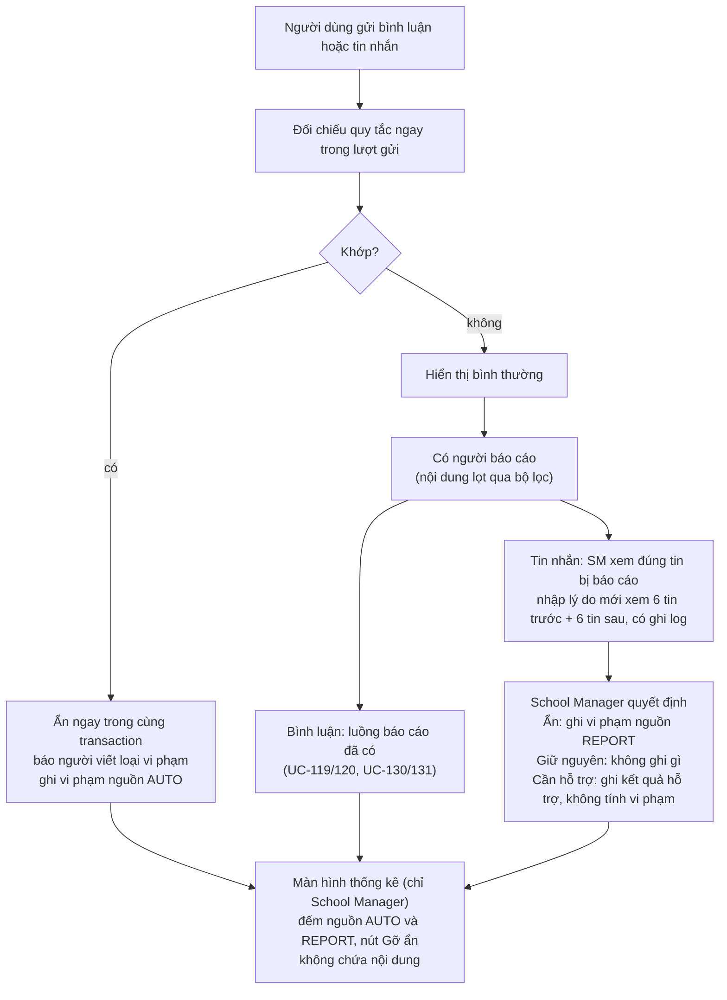

# Kế hoạch chức năng Kiểm duyệt nội dung tự động — EduConnect

> **Đã triển khai đủ 6 giai đoạn ngày 25/11/2026; mọi luật chính thức nằm trong `docs/business-rules.md` (§17).**

> Bản làm việc cho Claude Code, xuất từ tài liệu kế hoạch ngày 25/11/2026 (https://claude.ai/artifact/AYXquPuC5LKT1KaufmxDaG). Chủ chức năng: Anh (FE-08).
>
> - Các mục trong "Các quyết định đã chốt" là quyết định của chủ chức năng: không tự thay đổi phạm vi, tên bảng, tên cột hay luồng; chỗ nào chưa rõ thì dừng lại và hỏi.
> - Mọi quy tắc trong `CLAUDE.md` vẫn áp dụng. Riêng với chức năng này: không chạy DDL trên Supabase (patch để trong `database/`, chủ chức năng tự chạy); thử mọi endpoint ghi dữ liệu trên database dùng một lần; không commit, push hay tạo PR.
> - Làm theo từng giai đoạn ở mục "Kế hoạch triển khai", xong giai đoạn nào thì dừng để chủ chức năng kiểm.

## Mục tiêu và phạm vi

Mọi bình luận và tin nhắn được kiểm ngay trong lượt gửi; nội dung khớp quy tắc bị ẩn tự động, không cần ai duyệt, và người viết được báo vi phạm loại gì. Nội dung lọt qua bộ lọc được xử lý bằng báo cáo của người dùng.

**Các quyết định đã chốt (25/11/2026)**

| Vấn đề | Quyết định |
| --- | --- |
| Duyệt trước khi ẩn | Không. Khớp quy tắc là ẩn ngay |
| Gậy, khoá bình luận | Không có |
| Nội dung lọt bộ lọc | Người dùng báo cáo; bình luận dùng luồng báo cáo đã có, tin nhắn có luồng báo cáo mới |
| Ai xử lý báo cáo tin nhắn | School Manager |
| Mở một báo cáo tin nhắn | Chỉ thấy đúng tin bị báo cáo, không có tin xung quanh |
| Đoạn chat quanh tin bị báo cáo | Nút "Xem hội thoại xung quanh": nhập lý do rồi thấy 6 tin trước + 6 tin sau; không có xem toàn bộ hội thoại (đổi 27/11/2026) |
| Áp dụng cho | Mọi loại hội thoại, kể cả 1-1 |
| Ai được gỡ ẩn khi máy bắt nhầm | Chỉ School Manager |
| Ai xem màn hình thống kê vi phạm | Chỉ School Manager |

**Trong phạm vi**

| Nội dung | Điểm tạo | Kiểm tự động | Báo cáo |
| --- | --- | --- | --- |
| Bình luận bài đăng trường | UC-65 | Có | Đã có: UC-119, UC-120 |
| Bình luận bài đăng nhóm | UC-41 | Có | Đã có: UC-130, UC-131 |
| Tin nhắn (mọi loại nhóm, kể cả 1-1) | UC-47 | Có | Mới |
| Bài đăng nhóm (FE-05, từ 27/11/2026) | UC-38, UC-39 | Có — chặn trước khi đăng (xem "Bài đăng nhóm") | Không (luồng cũ: GVCN từ chối / ẩn) |

**Ngoài phạm vi**

- Bài đăng trường, bài hoạt động ngoại khoá (FE-07), tệp đính kèm, ảnh, video — chỉ kiểm phần chữ của bình luận, tin nhắn và bài đăng nhóm.
- Quy tắc tự động cho nội dung tự hại — loại này chỉ đi qua báo cáo "Cần được hỗ trợ", không bao giờ bị ẩn tự động.
- Gửi nội dung sang dịch vụ AI bên ngoài — dữ liệu không rời hệ thống.
- Gậy, khoá, hạn chế quyền của người vi phạm.

## Ba luồng xử lý

Máy xử lý phần chắc chắn vi phạm mà không cần ai; con người chỉ xuất hiện ở hai chỗ: xử lý báo cáo cho nội dung lọt qua, và gỡ ẩn khi máy bắt nhầm.



Mọi đường đều đổ về một màn hình thống kê duy nhất, đọc từ một bảng `moderation_violations`; báo cáo "Cần được hỗ trợ" là đường duy nhất không bao giờ vào đó.

## Luồng tự động

Kiểm nằm **trong** lượt gửi và ẩn trong cùng transaction với lúc ghi, nên không có khoảnh khắc nào người khác nhìn thấy nội dung vi phạm. Quét ở một bước chạy sau sẽ để lộ vài giây, nhất là tin nhắn vì socket phát gần như tức thì.

1. Người dùng bấm gửi.
2. Server chuẩn hoá văn bản và đối chiếu bộ quy tắc đã nạp sẵn trong bộ nhớ.
3. Không khớp: lưu bình thường.
4. Khớp: trong cùng một transaction, lưu nội dung ở trạng thái ẩn và ghi một dòng `moderation_violations` (nguồn `AUTO`).
5. Sau COMMIT: phát sự kiện realtime (người khác chỉ nhận chỗ trống), gửi thông báo cho người viết, trả về cho người gửi `moderation: { hidden: true, category }`.

**Loại vi phạm.** Không còn mức độ LOW/HIGH: khớp là ẩn. Mỗi quy tắc mang một loại để báo cho người viết và để thống kê.

| Mã | Hiển thị |
| --- | --- |
| `INAPPROPRIATE_LANGUAGE` | Ngôn từ thô tục |
| `HARASSMENT` | Xúc phạm, quấy rối |
| `SEXUAL` | Nội dung tình dục |
| `VIOLENCE` | Bạo lực, đe doạ |
| `DISCRIMINATION` | Kỳ thị |

Nội dung khớp nhiều quy tắc: ghi đủ các quy tắc vào `rule_ids`, loại hiển thị là loại **nghiêm trọng nhất** theo thứ tự `CATEGORIES` trong `utils/moderation.js`: bạo lực, đe doạ → nội dung tình dục → kỳ thị → xúc phạm, quấy rối → ngôn từ thô tục.

**Người viết thấy gì**

- Ngay sau khi gửi, một dòng `notice` dưới ô nhập: *"Bình luận của bạn đã bị ẩn vì vi phạm quy chuẩn cộng đồng: ngôn từ thô tục."*
- Một thông báo cá nhân trong chuông, nêu nơi đăng và loại vi phạm, không trích từ bị bắt.
- Nội dung của chính mình vẫn hiện, mờ đi, kèm `pill` "Đã bị ẩn", để biết câu nào bị ẩn.

**Người khác thấy gì**

- Bình luận: không thấy gì, số đếm bình luận không tính nó.
- Tin nhắn: bong bóng trống *"Tin nhắn đã bị ẩn do vi phạm quy chuẩn cộng đồng"*. Tin nhắn không biến mất hẳn vì nó nằm trong dòng hội thoại; mất đi sẽ làm các câu trả lời sau nó vô nghĩa.

**Gỡ ẩn — lưới an toàn duy nhất khi máy bắt nhầm.** School Manager mở một lần vi phạm trên màn hình thống kê, thấy đúng mẩu nội dung đó (không phải cả hội thoại), bấm "Gỡ ẩn" và nhập lý do. Nội dung hiện lại, lần vi phạm chuyển sang `UNHIDDEN` và không còn được đếm, các quy tắc đã khớp được tính một lần bắt oan. Người viết nhận thông báo *"Bình luận của bạn đã được hiển thị lại sau khi xem xét."*

**Gỡ ẩn chỉ dành cho vi phạm nguồn `AUTO`** (sửa lỗi của máy). Vi phạm nguồn `REPORT` là quyết định của người xử lý báo cáo, không có nút gỡ ẩn.

**Ghi vi phạm cho nội dung đã từng được gỡ ẩn.** Một nội dung chỉ có một dòng vi phạm. Nếu nội dung đã có dòng `UNHIDDEN` mà lại bị xác định vi phạm (ví dụ: bị báo cáo và SM ẩn), dòng đó được đưa về `ACTIVE` (xoá `unhidden_by`, `unhidden_at`, `unhide_reason`), giữ nguyên `source`, `category`, `rule_ids`: người xem xét vừa xác nhận quy tắc bắt đúng, lần gỡ ẩn trước mới là nhầm. Dòng đang `ACTIVE` thì giữ nguyên.

**Nội dung đã bị ẩn thì người viết không tự xoá hay thu hồi được.** Bình luận bị hệ thống ẩn không xoá được, tin nhắn bị hệ thống ẩn không thu hồi được; chỉ School Manager gỡ ẩn. Lý do: thu hồi sẽ ghi `deleted_for_everyone_by` và làm nút gỡ ẩn mất tác dụng, đồng thời cho phép người vi phạm xoá dấu vết.

**Bộ kiểm lỗi thì vẫn cho gửi.** Nếu bước kiểm ném lỗi, server ghi log và lưu nội dung bình thường; một lỗi trong bộ lọc không được làm tê liệt chat của cả trường. Khoá `moderation.enabled` trong `system_settings` tắt toàn bộ luồng này khi cần.

**Chỉ kiểm lúc gửi (Anh, 27/11/2026).** Bình luận, tin nhắn và bài đăng nhóm chỉ được kiểm khi gửi / lưu. Thêm, sửa hay bật lại một quy tắc không bao giờ quét lại nội dung đã gửi; nội dung cũ do báo cáo và người duyệt xử lý (business-rules §5). Lý do: một quy tắc sai không thể ẩn hàng loạt nội dung cũ; bài đã duyệt không bị lật lại; không tốn tải quét lại toàn bộ dữ liệu.

## Bài đăng nhóm (FE-05) — chặn trước khi đăng (Anh, 27/11/2026)

Bình luận và tin nhắn bị **ẩn** sau khi lưu; bài đăng nhóm thì bị **chặn**: bài được lưu nhưng không bao giờ lên bảng tin, và đây **không phải một lần vi phạm**.

- **Khi nào quét:** lúc tạo bài (UC-38) và mỗi lần lưu bài đã sửa (UC-39), nhóm bật hay tắt duyệt đều quét. Chỉ quét `content`, không quét tệp / ảnh. Không quét bài của người duyệt nhóm (GVCN ở nhóm lớp, SM ở nhóm giáo viên), bài đăng trường, bài hoạt động FE-07. Dùng đúng `moderateText` (gọi trước transaction, không chờ DB); `moderation.enabled = 'false'` thì không quét. Bài không `BLOCKED` lưu mà không đổi gì (`changed: false`) thì không quét lại. Bài `BLOCKED` lưu mà không đổi nội dung và tệp vẫn **quét lại**: còn khớp → giữ `BLOCKED`, không ghi gì; sạch (quy tắc đã được sửa hoặc xoá trong lúc đó) → phát hành như bài mới (xem "Sửa bài").
- **Khớp quy tắc:** bài lưu với `posts.approval_status = 'BLOCKED'` ("Chưa đăng – vi phạm quy chuẩn cộng đồng"). Không vào hàng chờ duyệt, không lên bảng tin, không thông báo cho ai (kể cả người viết — họ thấy ngay trên màn hình). Không ghi `moderation_violations`, không vào thống kê, SM không thấy, không có gỡ ẩn. Realtime: chỉ phát cho người viết; bài đang live hoặc đang chờ duyệt mà bị sửa thành vi phạm thì phát `post:changed` (chỉ id) như mọi lần bài rời bảng tin / hàng chờ.
- **Ai thấy:** chỉ người viết (tab "Bài của tôi", trang chi tiết, khung soạn). GVCN / SM / thành viên khác: không ở view nào; mở trực tiếp thì như bài không tồn tại (404). Hàng chờ báo cáo bình luận không hiện trích đoạn của bài `BLOCKED`.
- **Người viết được gì:** sửa, xoá. Không thích, không bình luận. Người duyệt không duyệt / từ chối / ghim / ẩn được bài `BLOCKED` (404).
- **Phản hồi:** object bài (chỉ khi người xem là tác giả) có `moderation: { category, terms }`. `terms` là các mẫu của quy tắc đã khớp, tính lại bằng bộ quy tắc trong bộ nhớ lúc đọc (không lưu cột nào); quy tắc đã đổi và không còn khớp → `{ category: null, terms: [] }`. `POST /groups/:id/posts` và `PATCH /posts/:id` vẫn trả 201 / 200 kèm bài, không trả lỗi.
- **Sửa bài:** nội dung mới vi phạm → `BLOCKED` (rời bảng tin / hàng chờ, bỏ ghim; giữ nguyên `is_hidden` / `hidden_by` / `hidden_at`, nên bài bị ẩn khi sửa sạch vẫn về GVCN duyệt). Bài `BLOCKED` sửa sạch → **phát hành như bài mới**: trạng thái theo công thức cũ của `updatePost` (`APPROVED` khi tắt duyệt và không bị ẩn, ngược lại `PENDING`), xoá trạng thái ẩn, gửi `notifyGroupPost` / `notifyPostPending`, `created_at = NOW()`, `updated_at = NULL`. Bài không `BLOCKED` sửa sạch → luồng cũ.
- **Giao diện:** khung soạn không đóng khi bài bị chặn mà chuyển sang sửa chính bài đó, hiện *"Bài viết có từ ngữ vi phạm quy chuẩn cộng đồng (<loại>). Hãy sửa lại để đăng."* và *"Từ ngữ cần sửa: …"*. Tab "Bài của tôi": nhãn đỏ "Chưa đăng – vi phạm quy chuẩn cộng đồng", cùng thông báo, nút Sửa bài / Xoá bài. Không còn quy tắc nào khớp (`terms` rỗng): khung soạn ghi *"Quy chuẩn đã được cập nhật. Hãy bấm <tên nút> để kiểm tra lại."* (tên nút đang hiện: "Gửi duyệt" hoặc "Đăng bài"), thẻ "Bài của tôi" và trang chi tiết ghi *"Quy chuẩn đã được cập nhật. Hãy bấm Sửa rồi đăng lại."*; nút lưu của bài `BLOCKED` luôn bật.
- **Bài lọt qua quy tắc:** giữ nguyên luồng cũ (GVCN từ chối / ẩn, không lý do, không thống kê).
- **DB:** `patch_v0.3_moderation.sql` bước 6 đổi CHECK `posts.approval_status` thành `('APPROVED','PENDING','REJECTED','BLOCKED')` (tên ràng buộc tìm trong `pg_constraint`, chạy lại được).

## Luồng báo cáo

Báo cáo là lưới thứ hai cho nội dung lọt qua bộ lọc. Bình luận giữ nguyên luồng đang có, tin nhắn có luồng mới làm theo đúng khuôn đó, và cả hai thêm một lý do mới: **Cần được hỗ trợ**.

**Lý do báo cáo**

| Mã | Hiển thị | Cách xử lý |
| --- | --- | --- |
| `INAPPROPRIATE_LANGUAGE` | Ngôn từ không phù hợp | Ẩn hoặc giữ nguyên |
| `HARASSMENT` | Xúc phạm, quấy rối | Ẩn hoặc giữ nguyên |
| `SPAM` | Spam | Ẩn hoặc giữ nguyên |
| `FALSE_INFORMATION` | Thông tin sai sự thật | Ẩn hoặc giữ nguyên |
| `OTHER` | Lý do khác (bắt buộc ghi chú) | Ẩn hoặc giữ nguyên |
| `NEEDS_SUPPORT` | **Cần được hỗ trợ** (tự hại, bị bắt nạt, bị bạo hành, khủng hoảng) | Tiếp nhận và ghi kết quả hỗ trợ |

**Lý do "Cần được hỗ trợ" đi một đường riêng.** Một học sinh nhắn "không muốn sống nữa" không vi phạm gì; em đang cần giúp. Việc của người xử lý không phải ẩn hay không ẩn mà là ghi nhận đã can thiệp bên ngoài.

|  | Báo cáo vi phạm thường | Báo cáo Cần được hỗ trợ |
| --- | --- | --- |
| Vị trí trong hàng đợi | Theo thời gian | Luôn lên đầu, đánh dấu riêng |
| Người xử lý được báo | Chỉ số đếm trên menu | Thông báo ngay, kèm realtime |
| Quyết định | Ẩn / Giữ nguyên | **Đã tiếp nhận**, bắt buộc ghi kết quả: đã báo GVCN, đã liên hệ phụ huynh, đánh giá không nghiêm trọng… |
| Báo người viết | Có, khi bị ẩn | **Không bao giờ** |
| Tính vào số lần vi phạm | Có, khi bị ẩn | **Không bao giờ** |

**Bình luận — giữ luồng đang có, thêm ba điểm**

- Người xử lý giữ nguyên: School Manager với bài trường (SCR-83), GVCN với nhóm lớp và School Manager với nhóm giáo viên (UC-131).
- Thêm lý do `NEEDS_SUPPORT` với cách xử lý ở bảng trên.
- Khi người xử lý xoá bình luận qua báo cáo, ghi thêm một dòng `moderation_violations` nguồn `REPORT`, để lần vi phạm này hiện trên màn hình thống kê.

**Tin nhắn — luồng mới**

*Người báo cáo:*

- Thành viên đang ở trong nhóm, báo cáo tin của người khác. Không báo cáo được tin của chính mình, tin hệ thống, tin đã thu hồi hoặc đã bị ẩn.
- Mỗi người một lần cho mỗi tin; báo cáo lại trả về thành công và không đổi gì, như bình luận.
- Người bị báo cáo không bao giờ biết ai báo cáo.
- Thao tác: giữ hoặc bấm chuột phải vào tin → "Báo cáo" → chọn lý do.

*School Manager xử lý:*

1. Hàng đợi "Báo cáo tin nhắn": mỗi dòng là một tin bị báo cáo, kèm tên nhóm, loại nhóm, người gửi (họ tên, vai trò, lớp), các lý do và số người chọn mỗi lý do, ghi chú. Mục có `NEEDS_SUPPORT` luôn ở đầu.
2. Mở một mục: chỉ thấy đúng tin bị báo cáo (nội dung, người gửi, thời điểm, tên tệp đính kèm), không có tin nào xung quanh. Lần xem này không ghi nhật ký.
3. Nếu cần, bấm **Xem hội thoại xung quanh**, nhập lý do: thấy 6 tin trước + 6 tin sau tin bị báo cáo (của mọi người trong cuộc trò chuyện), tin bị báo cáo được tô nổi. Mỗi lần xem ghi nhật ký kèm lý do. Không có cách nào xem nhiều hơn (điều kiện ở mục Quyền xem nội dung).
4. Ra một quyết định cho cả tin, đóng mọi báo cáo đang chờ của tin đó:
   - **Ẩn tin nhắn**: tin bị ẩn với mọi người, ghi vi phạm nguồn `REPORT` với loại là lý do được chọn nhiều nhất (trừ `NEEDS_SUPPORT`), người viết nhận thông báo kèm loại đó.
   - **Giữ nguyên**: không đổi gì với tin, không ai nhận thông báo.
   - Nếu trong các báo cáo có `NEEDS_SUPPORT`: dù ẩn hay giữ, bắt buộc ghi thêm **kết quả hỗ trợ**. Phần này không bao giờ được báo cho người viết.
   - Nếu mọi báo cáo đang chờ của một nội dung đều là `NEEDS_SUPPORT` thì chỉ được **Ghi nhận** (giữ nguyên + kết quả hỗ trợ), không được Ẩn/Xoá. Ẩn/Xoá cần ít nhất một báo cáo có lý do khác, và loại vi phạm lấy từ các lý do khác đó. Luật này áp dụng cho cả tin nhắn và bình luận.
5. Mọi quyết định ghi `logActivity`.
6. Tab **Đã xử lý**: mỗi báo cáo hiện "Hành vi xử lý" – quyết định (Ẩn / Giữ nguyên), SM đã quyết định, thời điểm, có hay không kết quả hỗ trợ (kèm nội dung), và mọi lần xem hội thoại xung quanh (tên SM, thời điểm, lý do; lấy từ `activity_logs`). Mọi School Manager đều thấy. Không ai xem thì ghi "Không xem hội thoại xung quanh".

## Quyền xem nội dung và nhật ký

School Manager được đọc tin nhắn riêng, kể cả trong hội thoại 1-1, nhưng tối đa 6 tin trước + 6 tin sau một tin bị báo cáo (27/11/2026). Đây là bước mở rộng quyền lớn nhất của chức năng, nên nó được rào để trở thành "điều tra một báo cáo cụ thể, có ghi lại" chứ không phải "đọc được tin nhắn riêng".

**Ai thấy gì**

| Người xem | Thấy | Điều kiện |
| --- | --- | --- |
| School Manager | Con số trên màn hình thống kê, không có nội dung | Luôn |
| School Manager | Đúng một mẩu nội dung đã bị ẩn | Khi mở một lần vi phạm để cân nhắc gỡ ẩn |
| School Manager | Đúng tin bị báo cáo | Báo cáo tin nhắn đang mở (không ghi nhật ký) |
| School Manager | 6 tin trước + 6 tin sau tin bị báo cáo, của mọi người trong nhóm | Báo cáo đang mở + đã nhập lý do (ghi nhật ký) |
| School Manager | Hành vi xử lý của báo cáo đã xử lý: quyết định, người, thời điểm, kết quả hỗ trợ, các lần xem hội thoại xung quanh kèm lý do | Luôn, mọi School Manager |
| System Admin | Nhật ký các lần xem trên, không có nội dung | Luôn |
| GVCN, người khác | Không có gì mới | — |

**Rào chắn cho nút "Xem hội thoại xung quanh"**

1. **Chỉ vào được từ một báo cáo.** Không có trang nào để chọn một nhóm chat bất kỳ rồi mở ra đọc; nút chỉ mở đúng nhóm chứa tin bị báo cáo.
2. **Chỉ khi báo cáo còn mở.** Xử lý xong thì nút biến mất: quyền xem gắn với một việc đang làm, không phải quyền thường trực.
3. **Bắt buộc nhập lý do trước khi mở** (không rỗng, tối đa 500 ký tự), lưu cùng lần xem; mọi SM thấy lại lý do ở tab Đã xử lý.
4. **Giới hạn cứng 6 + 6.** Không có xem toàn bộ hội thoại, không tải thêm trang (bỏ 27/11/2026). `moderation.context_window` mặc định 6, luôn giữ trong 0-20.
5. **Chỉ đọc.** Không gửi tin, không xuất, không tải tệp hàng loạt; tệp đính kèm hiện tên, bấm từng cái mới mở. Tin đã thu hồi vẫn là chỗ trống. Ngoại lệ duy nhất: chính tin bị báo cáo, nếu người gửi thu hồi nó **sau** thời điểm báo cáo đầu tiên của tin đó, SM vẫn thấy nội dung, kèm cờ `recalledAfterReport`; mục đích là chặn việc thu hồi để xoá bằng chứng sau khi bị báo cáo.
6. **Không báo cho thành viên nhóm** khi SM mở xem, vì trong ca bắt nạt hay tự hại, báo trước có thể làm hỏng việc xử lý. Thay vào đó là thông báo chung từ trước trong điều khoản sử dụng (bên dưới).

**Nhật ký.** Dùng bảng `activity_logs` và `logActivity` sẵn có, thêm các `action` mới, `detail` là JSON không chứa nội dung:

| `action` | Khi nào | `detail` |
| --- | --- | --- |
| `CHAT_CONTEXT_VIEW` | Mỗi lần xem hội thoại xung quanh (6 + 6) | `reportMessageId`, `groupId`, `reason` |
| `MODERATION_ITEM_VIEW` | Xem một mẩu nội dung đã bị ẩn | `violationId` |
| `MODERATION_UNHIDE` | Gỡ ẩn | `violationId`, `reason` |
| `MESSAGE_REPORT_RESOLVE` | Quyết định một báo cáo tin nhắn | `messageId`, `action`, có kết quả hỗ trợ hay không |
| `MODERATION_RULE_CHANGE` | Thêm, sửa, tắt quy tắc | `ruleId`, thay đổi |

System Admin đọc được nhật ký này nhưng không đọc được nội dung. Đó là câu trả lời cho câu hỏi "ai kiểm soát người kiểm soát".

**Điều khoản sử dụng.** Thêm một đoạn, hiện ở lần đăng nhập đầu và một dòng nhỏ trong khung chat: *"Bình luận và tin nhắn được kiểm tự động theo quy chuẩn cộng đồng của trường. Khi có báo cáo, Ban giám hiệu có thể xem nội dung hội thoại liên quan để bảo đảm an toàn cho học sinh."* Có câu này thì việc xem là có thông báo trước theo Nghị định 13/2023/NĐ-CP, không phải xem lén.

**Luật nghiệp vụ cần ghi vào `business-rules.md`:**

> School Manager được xem nội dung chat của một nhóm chỉ khi xử lý một báo cáo tin nhắn đang mở của nhóm đó: mặc định chỉ đúng tin bị báo cáo, và 6 tin trước + 6 tin sau sau khi nhập lý do, không bao giờ nhiều hơn; và được xem một mẩu nội dung đã bị ẩn tự động để quyết định gỡ ẩn. Mỗi lần xem được ghi lại; System Admin xem được nhật ký này nhưng không xem được nội dung.

## Màn hình "Quy chuẩn cộng đồng" của School Manager

Một trang, bốn tab, chỉ School Manager vào được. Toàn bộ là bảng và bộ lọc, không phải dashboard, để khớp với `screens.md`. Mục menu có số đếm báo cáo tin nhắn đang chờ, tô nổi khi có mục "Cần được hỗ trợ".

Bộ lọc dùng chung cho ba tab đầu: khoảng thời gian (tuần này, tháng này, học kỳ, năm học, tự chọn), khối, lớp, vai trò, loại vi phạm, nguồn (bình luận / tin nhắn), cách phát hiện (tự động / qua báo cáo).

**Tab 1 — Người vi phạm**, xếp theo số lần vi phạm giảm dần

| Cột | Ghi chú |
| --- | --- |
| Họ tên, vai trò, lớp | Tìm không dấu bằng `utils/search.js`; sắp tên theo `utils/nameSort.js` khi trùng số lần |
| Tổng số lần vi phạm | Trong khoảng đang lọc |
| Theo loại | Ví dụ "Thô tục 4 · Xúc phạm 1" |
| Nguồn | Bình luận / tin nhắn |
| Cách phát hiện | Tự động / qua báo cáo |
| Lần gần nhất | Ngày giờ |
| Xu hướng | So với khoảng liền trước cùng độ dài: tăng, giảm, như cũ |

Nút **Xuất Excel** qua `utils/excel.js` sẵn có, vì SM sẽ cần mang danh sách đi họp.

Bấm vào một người → **lịch sử chi tiết**: mỗi dòng một lần vi phạm với thời điểm, loại, nơi xảy ra (bài đăng trường, nhóm nào, hội thoại nào), cách phát hiện, trạng thái (đang ẩn / đã gỡ ẩn). Nút **Xem** hiện đúng mẩu nội dung đó (có ghi nhật ký) và nút **Gỡ ẩn** bắt buộc nhập lý do.

**Tab 2 — Theo lớp.** Số vi phạm theo khối và lớp, số học sinh có ít nhất một lần, loại hay gặp nhất. Dùng để thấy lớp nào cần GVCN nhắc nhở chung thay vì xử lý từng em. Lớp lấy theo lớp của học sinh **tại thời điểm vi phạm**, lưu sẵn trong `moderation_violations.class_id`, để lên lớp hay chuyển lớp không làm lệch số cũ.

**Tab 3 — Quy tắc.** Quản lý bộ quy tắc và đo chất lượng của từng quy tắc trong cùng một bảng.

| Cột | Ghi chú |
| --- | --- |
| Từ / cụm từ, kiểu khớp | `WORD` hoặc `PHRASE` |
| Khớp cả không dấu | Bật / tắt |
| Loại vi phạm |  |
| Số lần khớp | Trong khoảng đang lọc |
| Số lần bị gỡ ẩn | Tỉ lệ cao = quy tắc đang bắt oan |
| Trạng thái | Đang dùng / đã tắt |

Nút thêm, sửa, tắt quy tắc; thay đổi có hiệu lực ngay, không cần deploy. Cột "số lần bị gỡ ẩn" cũng là nguồn con số độ chính xác cho báo cáo trước hội đồng.

**Tab 4 — Báo cáo tin nhắn.** Hàng đợi ở mục Luồng báo cáo; hai bộ lọc "Đang chờ" / "Đã xử lý". Báo cáo bình luận bài trường vẫn ở SCR-83 như cũ.

**Đếm một lần vi phạm**

| Trường hợp | Tính |
| --- | --- |
| Bị ẩn tự động | 1 |
| Qua báo cáo, người xử lý ẩn hoặc xoá | 1 |
| Qua báo cáo, giữ nguyên | 0 |
| Bị ẩn rồi được gỡ ẩn | 0, tính là một lần bắt oan của quy tắc |
| Báo cáo "Cần được hỗ trợ" | Không bao giờ |

Mọi con số đọc từ một bảng duy nhất `moderation_violations`, điều kiện `status = 'ACTIVE'`. Không có bản sao nội dung nào trong bảng đó.

## Thiết kế dữ liệu

Ba bảng mới, hai cột mới, một ràng buộc sửa, hai khoá cài đặt, trong một file `database/patch_v0.3_moderation.sql` chạy lại được nhiều lần. Tin nhắn không cần cột mới.

**Nguyên tắc: không bảng mới nào lưu bản sao nội dung.** Chỉ lưu `comment_id` hoặc `message_id`; nội dung luôn đọc từ bảng gốc qua đúng đường có kiểm quyền. Lưu bản sao là tạo một đường vòng quanh toàn bộ hệ thống phân quyền.

```sql
BEGIN;

-- 1. Bộ quy tắc: School Manager sửa được, không cần deploy
CREATE TABLE IF NOT EXISTS moderation_rules (
  rule_id            BIGINT GENERATED BY DEFAULT AS IDENTITY PRIMARY KEY,
  pattern            VARCHAR(100) NOT NULL,          -- chữ thường, giữ dấu như người ta gõ
  match_type         VARCHAR(10)  NOT NULL DEFAULT 'WORD',
  accent_insensitive BOOLEAN      NOT NULL DEFAULT FALSE,
  category           VARCHAR(30)  NOT NULL,
  is_active          BOOLEAN      NOT NULL DEFAULT TRUE,
  created_by BIGINT NULL REFERENCES users(user_id),
  created_at TIMESTAMPTZ NOT NULL DEFAULT NOW(),
  updated_by BIGINT NULL REFERENCES users(user_id),
  updated_at TIMESTAMPTZ NULL,
  deleted_at TIMESTAMPTZ NULL,
  CONSTRAINT moderation_rules_match_type_check CHECK (match_type IN ('WORD','PHRASE')),
  CONSTRAINT moderation_rules_category_check
    CHECK (category IN ('INAPPROPRIATE_LANGUAGE','HARASSMENT','SEXUAL','VIOLENCE','DISCRIMINATION'))
);
CREATE UNIQUE INDEX IF NOT EXISTS moderation_rules_pattern_key
  ON moderation_rules (pattern) WHERE deleted_at IS NULL;

-- 2. Mỗi lần vi phạm (tự động hoặc qua báo cáo): nguồn duy nhất của màn hình thống kê
CREATE TABLE IF NOT EXISTS moderation_violations (
  violation_id  BIGINT GENERATED BY DEFAULT AS IDENTITY PRIMARY KEY,
  content_type  VARCHAR(20) NOT NULL,             -- SCHOOL_COMMENT, GROUP_COMMENT, MESSAGE
  comment_id    BIGINT NULL REFERENCES comments(comment_id),
  message_id    BIGINT NULL REFERENCES messages(message_id),
  author_id     BIGINT NOT NULL REFERENCES users(user_id),
  class_id      BIGINT NULL REFERENCES classes(class_id),  -- lớp của học sinh lúc vi phạm
  source        VARCHAR(10) NOT NULL,             -- AUTO | REPORT
  category      VARCHAR(30) NOT NULL,
  rule_ids      BIGINT[] NULL,                    -- các quy tắc đã khớp, chỉ với AUTO
  status        VARCHAR(10) NOT NULL DEFAULT 'ACTIVE',   -- ACTIVE | UNHIDDEN
  unhidden_by   BIGINT NULL REFERENCES users(user_id),
  unhidden_at   TIMESTAMPTZ NULL,
  unhide_reason VARCHAR(500) NULL,
  created_at    TIMESTAMPTZ NOT NULL DEFAULT NOW(),
  CONSTRAINT moderation_violations_target_check CHECK ((comment_id IS NULL) <> (message_id IS NULL)),
  CONSTRAINT moderation_violations_source_check CHECK (source IN ('AUTO','REPORT')),
  CONSTRAINT moderation_violations_rules_check  CHECK ((source = 'AUTO') = (rule_ids IS NOT NULL)),
  CONSTRAINT moderation_violations_status_check CHECK (status IN ('ACTIVE','UNHIDDEN')),
  CONSTRAINT moderation_violations_unhide_check
    CHECK ((status = 'UNHIDDEN') = (unhidden_at IS NOT NULL) AND (unhidden_at IS NULL) = (unhidden_by IS NULL)),
  CONSTRAINT moderation_violations_category_check
    CHECK (category IN ('INAPPROPRIATE_LANGUAGE','HARASSMENT','SEXUAL','VIOLENCE','DISCRIMINATION',
                        'SPAM','FALSE_INFORMATION','OTHER'))
);
-- Một nội dung chỉ có một lần vi phạm: gửi lại cùng clientMessageId không sinh dòng thứ hai
CREATE UNIQUE INDEX IF NOT EXISTS moderation_violations_comment_key ON moderation_violations (comment_id) WHERE comment_id IS NOT NULL;
CREATE UNIQUE INDEX IF NOT EXISTS moderation_violations_message_key ON moderation_violations (message_id) WHERE message_id IS NOT NULL;
CREATE INDEX IF NOT EXISTS moderation_violations_author_idx ON moderation_violations (author_id, created_at DESC);
CREATE INDEX IF NOT EXISTS moderation_violations_time_idx   ON moderation_violations (created_at DESC) WHERE status = 'ACTIVE';

-- 3. Báo cáo tin nhắn: cùng khuôn với comment_reports
CREATE TABLE IF NOT EXISTS message_reports (
  report_id    BIGINT GENERATED BY DEFAULT AS IDENTITY PRIMARY KEY,
  message_id   BIGINT NOT NULL REFERENCES messages(message_id),
  reported_by  BIGINT NOT NULL REFERENCES users(user_id),
  reason       VARCHAR(50)  NOT NULL,
  note         VARCHAR(500) NULL,
  status       VARCHAR(20)  NOT NULL DEFAULT 'PENDING',  -- PENDING, RESOLVED (đã ẩn), DISMISSED (giữ nguyên)
  support_note VARCHAR(1000) NULL,                       -- kết quả hỗ trợ, bắt buộc khi reason = NEEDS_SUPPORT được xử lý
  resolved_by  BIGINT NULL REFERENCES users(user_id),
  resolved_at  TIMESTAMPTZ NULL,
  created_at   TIMESTAMPTZ NOT NULL DEFAULT NOW(),
  deleted_at   TIMESTAMPTZ NULL,
  CONSTRAINT message_reports_message_id_reported_by_key UNIQUE (message_id, reported_by),
  CONSTRAINT message_reports_reason_check
    CHECK (reason IN ('INAPPROPRIATE_LANGUAGE','HARASSMENT','SPAM','FALSE_INFORMATION','NEEDS_SUPPORT','OTHER')),
  CONSTRAINT message_reports_status_check CHECK (status IN ('PENDING','RESOLVED','DISMISSED')),
  CONSTRAINT message_reports_resolved_check
    CHECK ((status = 'PENDING') = (resolved_at IS NULL) AND (resolved_at IS NULL) = (resolved_by IS NULL)),
  CONSTRAINT message_reports_support_check
    CHECK (reason <> 'NEEDS_SUPPORT' OR status = 'PENDING' OR support_note IS NOT NULL)
);
CREATE INDEX IF NOT EXISTS message_reports_queue_idx ON message_reports (status, created_at) WHERE deleted_at IS NULL;

-- 4. Bình luận: ẩn tách khỏi xoá, để gỡ ẩn được
ALTER TABLE comments ADD COLUMN IF NOT EXISTS hidden_at TIMESTAMPTZ NULL;

-- 5. Báo cáo bình luận: thêm lý do NEEDS_SUPPORT và kết quả hỗ trợ
ALTER TABLE comment_reports ADD COLUMN IF NOT EXISTS support_note VARCHAR(1000) NULL;
ALTER TABLE comment_reports DROP CONSTRAINT IF EXISTS comment_reports_reason_check;
ALTER TABLE comment_reports ADD CONSTRAINT comment_reports_reason_check
  CHECK (reason IN ('INAPPROPRIATE_LANGUAGE','HARASSMENT','SPAM','FALSE_INFORMATION','NEEDS_SUPPORT','OTHER'));

ALTER TABLE moderation_rules      ENABLE ROW LEVEL SECURITY;
ALTER TABLE moderation_violations ENABLE ROW LEVEL SECURITY;
ALTER TABLE message_reports       ENABLE ROW LEVEL SECURITY;

INSERT INTO system_settings (setting_key, setting_value, description) VALUES
  ('moderation.enabled',        'true', 'Scan comments and messages when they are sent'),
  ('moderation.context_window', '6',    'Messages shown before and after a reported message')
ON CONFLICT (setting_key) DO NOTHING;

COMMIT;
```

**Vì sao bình luận cần `hidden_at` riêng.** `deleted_at` là xoá, không khôi phục được khi SM gỡ ẩn, và `deleted_by` là khoá ngoại tới `users` nên phải bịa tài khoản hệ thống. Ẩn tự động dùng `hidden_at`; xoá qua báo cáo vẫn dùng `deleted_at` như cũ.

**Vì sao tin nhắn không cần cột mới.** Ẩn = đặt `deleted_for_everyone_at = NOW()` và để `deleted_for_everyone_by = NULL`. Mọi truy vấn đọc tin nhắn đã thay nội dung bằng chỗ trống, xoá cảm xúc và trích dẫn. Chỗ thu hồi duy nhất của người dùng (`messageActions.service.js`, dòng 69) luôn ghi `_by`, nên `_by IS NULL` là dấu hiệu chắc chắn của "bị ẩn do vi phạm". Gỡ ẩn chỉ được xóa `deleted_for_everyone_at` khi `_by IS NULL`, để không bao giờ làm sống lại một tin người gửi đã tự thu hồi.

**Vì sao không ghi vi phạm tự động vào `comment_reports`.** Bảng đó bắt buộc `reported_by` là người thật và có `UNIQUE (comment_id, reported_by)`; ghép nguồn hệ thống vào đó buộc phải tạo tài khoản giả.

## Bộ quy tắc và chuẩn hoá tiếng Việt

Không còn người duyệt, nên độ chính xác của bộ kiểm quyết định trực tiếp ai bị ẩn oan. Việc kiểm là một hàm thuần `checkContent(text, rules)` trong `server/src/utils/moderation.js`, không đụng database, trả về danh sách quy tắc khớp và loại vi phạm.

**Các bước chuẩn hoá, theo thứ tự**

1. Unicode NFC và về chữ thường — gõ bằng hai bộ gõ khác nhau cho ra cùng một chuỗi.
2. Tách theo khoảng trắng thành cụm; thay số và ký tự giả chữ **chỉ trong cụm có cả chữ cái và số**: `0→o`, `1→i`, `3→e`, `4→a`, `@→a`. "Phòng 104" không bị đụng. Phải làm trước bước tách từ, vì `@` không phải chữ cái.
3. Tách từ theo chữ cái Unicode (`\p{L}\p{M}`); số, dấu câu, biểu tượng cảm xúc là ranh giới.
4. Ghép chữ cái đứng lẻ bị chèn ký tự: `đ.m`, `đ m`, `d_m` → `đm`, chỉ với chuỗi từ hai chữ đơn trở lên.
5. Gom chữ lặp từ ba lần: `đmmmm` → `đm`. Tiếng Việt không có từ nào lặp một chữ ba lần.
6. Sinh thêm bản bỏ dấu bằng `foldVietnamese` có sẵn trong `utils/search.js`.

**Đối chiếu theo từ, không theo chuỗi con.** `WORD` khớp đúng một từ nguyên vẹn; `PHRASE` khớp một dãy từ liên tiếp. Kiểu `includes()` là nguồn bắt oan lớn nhất, vì một từ cấm ngắn nằm lọt trong rất nhiều từ vô hại.

**Bỏ dấu là con dao hai lưỡi.** Nó bắt được người cố tình gõ không dấu, nhưng nhiều từ tục khi bỏ dấu trùng với những từ thông dụng nhất của tiếng Việt. Vì vậy mỗi quy tắc có cờ `accent_insensitive`:

- `FALSE` (mặc định): chỉ khớp đúng dấu.
- `TRUE`: khớp cả bản không dấu. Chỉ bật cho từ mà bản không dấu không trùng từ thường nào.
- Teen code vốn không dấu (`vcl`, `clgt`, `dcm`) ghi thẳng không dấu, cờ này không ảnh hưởng.

**Nạp quy tắc vào bộ nhớ.** Đọc bảng một lần lúc khởi động, dựng thành `Map` từ → quy tắc; nạp lại ngay khi SM sửa quy tắc và định kỳ mỗi 5 phút. Một bình luận vài chục từ tra vài chục lần trong `Map`, nhanh hơn nhiều so với chính lượt ghi xuống Supabase. `moderation.enabled` cũng đọc từ bộ nhớ đệm, không truy vấn mỗi lần có người gõ.

**Dữ liệu khởi tạo.** Danh sách ban đầu nằm trong `database/seed_moderation_rules.sql`, không nằm trong code. Bắt đầu nhỏ: vài chục từ chắc chắn là tục, đều `accent_insensitive = FALSE` trừ teen code. Mở rộng dần dựa trên bộ mẫu kiểm thử và cột "số lần bị gỡ ẩn".

**Không tạo quy tắc cho nội dung tự hại.** Câu "muốn chết" mà bị ẩn tự động là một lời kêu cứu bị xóa đi trước khi bạn bè kịp đáp lại. Loại này chỉ đi qua báo cáo "Cần được hỗ trợ"; ràng buộc `moderation_rules_category_check` không có loại đó, nên không ai tạo nhầm được.

## Điểm tích hợp trong code

Phần lớn code mới nằm trong một module riêng `server/src/modules/moderation/`; vào code có sẵn chỉ có bốn chỗ móc, đều là thêm chứ không đổi chữ ký hàm.

**Module mới `moderation`** (routes → controller → service, gắn vào `/api/v1/moderation` trong `routes.js`)

| Endpoint | Ai gọi | Việc |
| --- | --- | --- |
| `POST /message-reports` | Thành viên nhóm | Báo cáo một tin nhắn |
| `GET /message-reports?status=` | School Manager | Hàng đợi, `NEEDS_SUPPORT` lên đầu |
| `GET /message-reports/:messageId` | School Manager | Chỉ tin bị báo cáo, báo cáo còn mở; không ghi nhật ký |
| `POST /message-reports/:messageId/context` | School Manager | `{ reason }`: 6 tin trước + 6 tin sau, ghi `CHAT_CONTEXT_VIEW` kèm lý do |
| `PATCH /message-reports/:messageId` | School Manager | `{ action: HIDE \| KEEP, supportNote }` |
| `GET /violations` | School Manager | Tab Người vi phạm, có bộ lọc và phân trang |
| `GET /violations/export` | School Manager | File Excel |
| `GET /violations/users/:userId` | School Manager | Lịch sử một người |
| `GET /violations/:id/content` | School Manager | Đúng một mẩu nội dung, ghi `MODERATION_ITEM_VIEW` |
| `POST /violations/:id/unhide` | School Manager | Gỡ ẩn kèm lý do |
| `GET /violations/by-class` | School Manager | Tab Theo lớp |
| `GET, POST, PATCH, DELETE /rules` | School Manager | Tab Quy tắc; mỗi lần ghi thì nạp lại bộ nhớ đệm |

Báo cáo tin nhắn đặt trong module mới, không thêm route vào `conversations`, để không đụng vào module của người khác ngoài bốn chỗ móc dưới đây.

**Đường đọc hội thoại của SM phải là một hàm riêng.** Không nới `openChat` cho School Manager: hàm đó đang chặn mọi người không phải thành viên, và thêm ngoại lệ vào đó sẽ mở cho SM đọc **mọi** nhóm qua **mọi** API chat, kể cả gửi tin. Hàm mới `readReportedConversation(user, messageId, { before, limit })` tự kiểm đủ ba điều: người gọi đang ở vai trò School Manager, tin có báo cáo `PENDING`, chỉ trả tin của đúng nhóm đó. Ghi nhật ký nằm trong cùng hàm, để không có cách nào đọc mà không bị ghi.

**Bốn chỗ móc vào code có sẵn**

| File | Thay đổi | Dùng chung với |
| --- | --- | --- |
| `utils/feedInteractions.js` — `insertComment` (dòng 179) | Kiểm trước INSERT; khớp thì ghi `hidden_at = NOW()` ngay trong câu INSERT và INSERT vi phạm cùng transaction (bọc bằng `inTransaction(db, …)`); trả thêm `moderation` | FE-05 |
| `utils/feedInteractions.js` — `listComments`, `countComments`, `findComment` | Bỏ bình luận có `hidden_at`, trừ tác giả xem của chính mình (kèm `isHidden`); thích, trả lời, báo cáo bình luận đã ẩn trả 404 | FE-05 |
| `utils/commentReports.js` | Lý do `NEEDS_SUPPORT`, `support_note` bắt buộc, không báo tác giả, xếp lên đầu; xoá qua báo cáo thì ghi vi phạm `REPORT` | FE-05 |
| `modules/conversations/conversations.service.js` — `sendMessage` | Kiểm sau `cleanContent`; trong transaction, ngay sau INSERT: khớp thì đặt `deleted_for_everyone_at` và INSERT vi phạm. Thêm `isModerated` vào câu SELECT tin nhắn (quanh dòng 143) và bản xem trước tin cuối (quanh dòng 460); người gửi vẫn đọc được nội dung tin bị ẩn của chính mình | FE-06 |

**Vì sao socket không lộ nội dung.** `message:new` phát sau COMMIT từ `messageForViewers`, vốn đọc `CASE WHEN deleted_for_everyone_at IS NULL THEN content END`; ẩn trong cùng transaction thì người nhận chỉ nhận chỗ trống. Sự kiện bảng tin chỉ mang id, client tải lại qua `listComments`, nên sửa đúng ba hàm đọc là đủ.

**Các trường hợp biên ở chỗ gửi tin**

- Tin chỉ có tệp (`content` rỗng): bỏ qua.
- Tin hệ thống đi qua `publishNewMessages`, không qua `sendMessage`: tự đứng ngoài.
- Gửi lại cùng `clientMessageId`: `savedByClientId` thoát trước khi kiểm, cộng chỉ mục duy nhất trên `message_id`.
- Trả lời một tin đã ẩn: `findVisibleMessage` đã từ chối tin `isDeleted`.

**Thông báo và realtime.** Một file `utils/moderationNotify.js` theo khuôn `notifyCommentRemoved`: một `notifications` + một `notification_recipients` mỗi vai trò, gửi sau COMMIT, lỗi thì chỉ ghi log. Báo cáo `NEEDS_SUPPORT` mới thì phát `moderation:report` (chỉ mang id) tới `user:<id>` của mọi School Manager.

**Client**

- Trang mới `src/pages/moderation/`, route trong `App.jsx` bọc `ProtectedRoute roles={['SCHOOL_MANAGER']}`, mục menu trong `src/navigation.js` có số đếm.
- Khung chat: mục "Báo cáo" trên mỗi tin, bong bóng "đã bị ẩn do vi phạm", dòng ghi chú kiểm tự động.
- Bảng tin: dòng `notice` sau khi gửi, nhãn "Đã bị ẩn", lý do "Cần được hỗ trợ" trong hộp thoại báo cáo.
- Mã lỗi mới ánh xạ sang tiếng Việt trong `src/messages.js`.
- Khung chat và bảng tin là màn hình học sinh, phụ huynh dùng: các trạng thái mới phải kiểm trên bố cục di động.

## Kế hoạch triển khai

Bảy giai đoạn, làm theo thứ tự, mỗi giai đoạn có điều kiện "xong" kiểm được. Giai đoạn 1 không cần database nên bắt đầu được ngay. Nhánh tách từ `develop`; mọi thao tác ghi dữ liệu chỉ thử trên database dùng một lần (`server/scripts/dev-local-db.js`).

**Giai đoạn 1 — Bộ kiểm**

- [ ] `server/src/utils/moderation.js`: chuẩn hoá, tách từ, dựng `Map`, `checkContent(text, rules)`
- [ ] `utils/moderation.test.js` theo bảng trường hợp ở mục Kiểm thử
- [ ] Bộ mẫu khoảng 200 câu có gắn nhãn và script đo độ chính xác, độ phủ

Xong khi: `npm test` qua và bộ mẫu không bắt oan câu sạch nào.

**Giai đoạn 2 — Database**

- [ ] `database/patch_v0.3_moderation.sql`; cập nhật `educonnect_schema_v0.3.sql` cho khớp
- [ ] `database/seed_moderation_rules.sql`
- [ ] Chạy patch hai lần liền trên database dùng một lần

Xong khi: lần chạy thứ hai không báo lỗi, `npm run db:check` qua.

**Giai đoạn 3 — Tự động ẩn bình luận**

- [ ] Bộ nhớ đệm quy tắc và `moderation.enabled`
- [ ] Móc `insertComment`; sửa `listComments`, `countComments`, `findComment`
- [ ] `utils/moderationNotify.js`, thông báo người viết
- [ ] Client: dòng `notice`, nhãn "Đã bị ẩn"

Xong khi: các mục bình luận trong danh sách kiểm tích hợp qua và luồng bình luận nhóm của FE-05 không đổi.

**Giai đoạn 4 — Tự động ẩn tin nhắn**

- [ ] Móc `sendMessage`, ẩn bằng `deleted_for_everyone_at` trong transaction
- [ ] `isModerated` ở câu SELECT tin nhắn và bản xem trước tin cuối; người gửi vẫn đọc được tin của mình
- [ ] Client: bong bóng "đã bị ẩn do vi phạm", dòng ghi chú kiểm tự động

Xong khi: khung socket của người nhận không chứa nội dung gốc; gửi lại không sinh vi phạm thứ hai; luồng chat của FE-06 không đổi.

**Giai đoạn 5 — Báo cáo**

- [ ] `POST /message-reports` và hộp thoại báo cáo trong khung chat
- [ ] Hàng đợi, chỉ tin bị báo cáo (`getReportedMessage`), cửa sổ 6 + 6 kèm lý do (`readReportContext`), quyết định Ẩn / Giữ nguyên, hành vi xử lý ở tab Đã xử lý
- [ ] `NEEDS_SUPPORT` cho cả bình luận và tin nhắn: lên đầu, thông báo realtime cho SM, bắt buộc `support_note`, không báo người viết
- [ ] Xoá / ẩn qua báo cáo thì ghi vi phạm `REPORT`
- [ ] Nhật ký `CHAT_CONTEXT_VIEW` (kèm lý do), `MESSAGE_REPORT_RESOLVE`

Xong khi: các mục báo cáo và quyền xem trong danh sách kiểm tích hợp qua.

**Giai đoạn 6 — Màn hình Quy chuẩn cộng đồng**

- [ ] Tab Người vi phạm, lịch sử từng người, xem một mẩu nội dung, Gỡ ẩn, Xuất Excel
- [ ] Tab Theo lớp
- [ ] Tab Quy tắc: thêm, sửa, tắt, số lần khớp, số lần bị gỡ ẩn
- [ ] Tab Báo cáo tin nhắn, số đếm trên menu
- [ ] (Tuỳ chọn) `server/scripts/moderation-backfill.js` quét dữ liệu cũ: mặc định chỉ in kết quả, chỉ ghi khi có `--apply`

Xong khi: số trên màn hình khớp với đếm tay từ `moderation_violations`; sửa một quy tắc có hiệu lực ngay.

**Giai đoạn 7 — Tài liệu và đưa lên production**

- [ ] Cập nhật các tài liệu dự án ở mục cuối
- [ ] Chạy patch và seed trên Supabase **trước**, rồi mới `git pull` và restart trên VPS (DEPLOY.md §7)
- [ ] Thử thật trên production: gửi một bình luận và một tin nhắn vi phạm, báo cáo một tin, gỡ ẩn một mục

Xong khi: bốn mục kiểm ở DEPLOY.md §6 vẫn qua và ba lượt thử trên chạy đúng.

## Kiểm thử và chỉ số

Chức năng được chấm bằng hai con số đo được: bắt được bao nhiêu nội dung xấu và bao nhiêu lần bắt oan. Không có hai số đó thì trước hội đồng chỉ nói được là "có quét".

**1. Kiểm thử đơn vị cho `checkContent`** — `utils/moderation.test.js`, chạy bằng `npm test`.

| Nhóm trường hợp | Phải bắt | Không được bắt |
| --- | --- | --- |
| Ký tự chèn | `đ.m`, `đ m`, `d_m` | Danh sách "a, b, c" |
| Chữ lặp | `đmmmm` | Từ thật có hai chữ giống nhau liền nhau |
| Số thay chữ | Từ trộn chữ và số | "Phòng 104", "lớp 10A1" |
| Không dấu | Quy tắc có `accent_insensitive = TRUE` | Từ thường trùng bản không dấu của từ tục |
| Chuỗi con | — | Từ vô hại chứa từ cấm bên trong |
| Cụm từ | Cụm đúng thứ tự | Các từ của cụm nằm rải rác |
| Nội dung rỗng, chỉ biểu tượng cảm xúc | — | Không lỗi, không khớp |
| Nội dung tự hại | — | Không bao giờ khớp |

**2. Bộ mẫu có gắn nhãn — nguồn số liệu cho báo cáo.** Khoảng 200 câu tự soạn, 100 vi phạm và 100 sạch trong đó nhiều câu "bẫy". Script chạy `checkContent` trên cả bộ và in ra:

- **Độ chính xác** = số câu bắt đúng / tổng số câu bị bắt.
- **Độ phủ** = số câu bắt đúng / tổng số câu vi phạm.
- Từng câu bắt oan và bỏ sót, để sửa quy tắc rồi chạy lại.

Không còn người duyệt, nên ưu tiên **độ chính xác** hơn độ phủ: bỏ sót còn báo cáo đỡ, bắt oan thì chỉ còn SM gỡ ẩn. Bộ mẫu không chứa dữ liệu thật của học sinh.

**3. Kiểm tích hợp trên database dùng một lần**, không trên Supabase dùng chung.

*Tự động*

- [ ] Gửi bình luận vi phạm: người khác không thấy, số đếm không tăng, tác giả thấy nhãn "Đã bị ẩn" và nhận thông báo có loại vi phạm
- [ ] Thích, trả lời, báo cáo bình luận đã ẩn: 404
- [ ] Gửi tin nhắn vi phạm: DevTools › Network › Socket › Messages của người nhận **không chứa** nội dung gốc; người gửi vẫn đọc được tin của mình
- [ ] Gửi lại cùng `clientMessageId`: chỉ một dòng vi phạm
- [ ] `moderation.enabled = false`: mọi thứ gửi bình thường
- [ ] Cho `checkContent` ném lỗi: bình luận và tin nhắn vẫn được lưu
- [ ] Gỡ ẩn: nội dung hiện lại, không còn được đếm, quy tắc tăng một lần bị gỡ ẩn
- [ ] Gỡ ẩn không bao giờ làm hiện lại tin người gửi đã tự thu hồi

*Báo cáo và quyền xem*

- [ ] Báo cáo tin của chính mình, tin hệ thống, tin đã thu hồi: bị từ chối; báo cáo lại lần hai: 200, không đổi gì
- [ ] Báo cáo `NEEDS_SUPPORT`: lên đầu hàng đợi, SM nhận thông báo realtime, không đóng được nếu thiếu kết quả hỗ trợ, người viết không nhận gì, không tính vào số vi phạm
- [ ] Mở báo cáo: chỉ một tin, không ghi nhật ký
- [ ] Xem hội thoại xung quanh: thiếu lý do thì bị từ chối; cửa sổ 6 + 6 đúng nhóm, đúng thứ tự; mỗi lần xem có một dòng `CHAT_CONTEXT_VIEW` kèm lý do; báo cáo đã đóng thì không xem được nữa; endpoint full-view cũ trả 404
- [ ] Tab Đã xử lý: đủ các lần xem (tên, thời điểm, lý do), quyết định, kết quả hỗ trợ; không ai xem thì ghi "Không xem hội thoại xung quanh"
- [ ] SM gọi mọi API chat thường (`openChat`) với nhóm mình không tham gia: vẫn bị từ chối
- [ ] System Admin, GVCN, giáo viên gọi API `/moderation`: 403 (trừ báo cáo tin nhắn)
- [ ] System Admin đọc được nhật ký xem, không thấy nội dung nào

*Không làm hỏng thứ đang có*

- [ ] Luồng bình luận và báo cáo nhóm của FE-05 chạy như cũ
- [ ] Luồng chat của FE-06 chạy như cũ: gửi, trả lời, thu hồi, cảm xúc, đã đọc

**4. Chỉ số khi đã chạy thật**, đọc thẳng từ `moderation_violations`: số lần khớp và tỉ lệ bị gỡ ẩn theo từng quy tắc, tỉ lệ vi phạm tự động so với qua báo cáo, thời gian từ lúc có báo cáo đến lúc được xử lý. Quy tắc có tỉ lệ gỡ ẩn cao là quy tắc cần sửa hoặc tắt.

## Rủi ro và tài liệu dự án cần cập nhật

Bỏ khâu duyệt làm hệ thống gọn hơn, nhưng cũng dồn toàn bộ trách nhiệm lên độ chính xác của bộ quy tắc và lên nút gỡ ẩn của School Manager.

| Rủi ro | Cách xử lý |
| --- | --- |
| Bắt oan, ẩn nhầm lời của giáo viên hoặc phụ huynh mà không ai biết | Bộ quy tắc ban đầu nhỏ và chắc; đối chiếu theo từ; bỏ dấu chỉ khi được bật từng quy tắc; nút Gỡ ẩn; cột "số lần bị gỡ ẩn"; tắt toàn bộ bằng `moderation.enabled` |
| Người dùng nghĩ ra cách viết mới để lách | Sửa quy tắc không cần deploy; báo cáo vẫn chạy song song |
| Lời kêu cứu bị ẩn tự động | Không có loại quy tắc cho nội dung tự hại, ràng buộc database chặn luôn |
| Báo cáo "Cần được hỗ trợ" lúc nửa đêm, không ai thấy tới sáng | Nói rõ trong báo cáo đây không phải kênh ứng cứu khẩn cấp. Khi người báo cáo chọn lý do này, hiện ngay một dòng: *"Nếu bạn hoặc bạn mình đang gặp nguy hiểm, hãy báo ngay thầy cô hoặc gọi Tổng đài quốc gia bảo vệ trẻ em 111."* |
| Quyền xem hội thoại bị lạm dụng | Mặc định chỉ thấy tin bị báo cáo; tối đa 6 + 6, không có xem toàn bộ; chỉ từ báo cáo đang mở, bắt buộc lý do, nhật ký từng lần xem mà mọi SM thấy ở tab Đã xử lý, System Admin xem được nhật ký, điều khoản sử dụng nói trước |
| Nới `openChat` làm SM đọc được mọi nhóm | Đường đọc riêng `getReportedMessage` / `readReportContext`; kiểm thử khẳng định `openChat` vẫn từ chối SM |
| Lỗi trong bộ lọc làm hỏng chat | Bộ kiểm lỗi thì vẫn cho gửi, chỉ ghi log |
| Đụng code dùng chung với FE-05, FE-06 | Chỉ thêm, không đổi chữ ký hàm; chạy lại luồng của họ trước khi merge |
| Code mới lên VPS trước khi Supabase có bảng | Chạy patch trước, rồi mới `git pull` và restart |

**Giả định cần xác nhận:** School Manager là người quản lý bộ quy tắc (tab Quy tắc). Nếu muốn giao cho System Admin thì hợp lệ, vì quy tắc không phải nội dung; chỉ cần tách tab đó ra khỏi trang của SM.

**Tài liệu dự án cần cập nhật cùng code**

- [ ] `docs/business-rules.md`: §5 đang ghi "bình luận chỉ bị xoá, không bao giờ bị ẩn" — sửa; thêm một mục Quy chuẩn cộng đồng gồm luồng tự động, lý do `NEEDS_SUPPORT`, cách đếm vi phạm, và luật về quyền xem nội dung của SM ở mục Quyền xem nội dung
- [ ] `docs/permissions.md`: SM (thống kê, gỡ ẩn, xử lý báo cáo tin nhắn, xem hội thoại qua báo cáo, quy tắc); thành viên nhóm (báo cáo tin nhắn); System Admin (nhật ký xem)
- [ ] `docs/use-cases.md`: đang tới UC-133; đề xuất UC-134 Tự động kiểm nội dung khi gửi, UC-135 Báo cáo tin nhắn, UC-136 Xử lý báo cáo tin nhắn, UC-137 Xem thống kê vi phạm, UC-138 Gỡ ẩn nội dung, UC-139 Quản lý quy tắc kiểm duyệt; sửa UC-119, UC-130 (lý do mới) và UC-120, UC-131 (kết quả hỗ trợ)
- [ ] `docs/screens.md`: trang Quy chuẩn cộng đồng và bốn tab, lịch sử vi phạm của một người, hộp thoại báo cáo tin nhắn, màn hình xem hội thoại qua báo cáo
- [ ] `CLAUDE.md`: dòng "System Admin never sees content… School Manager never sees class feeds/chats" thêm ngoại lệ qua báo cáo, để agent sau này không "sửa" ngược lại
- [ ] `server/src/utils/activityLog.js` và ghi chú cột `action` trong schema: thêm sáu action mới
- [ ] `docs/iteration-plan.md`: mục Current status, patch đã chạy
- [ ] Điều khoản sử dụng: đoạn về kiểm tự động và quyền xem khi có báo cáo
